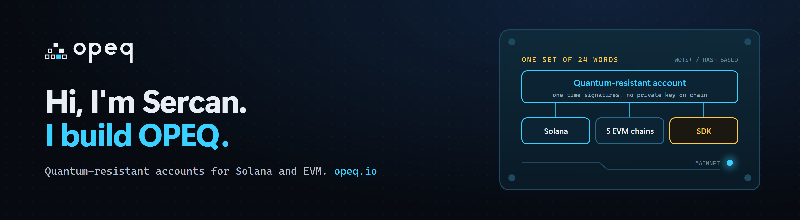
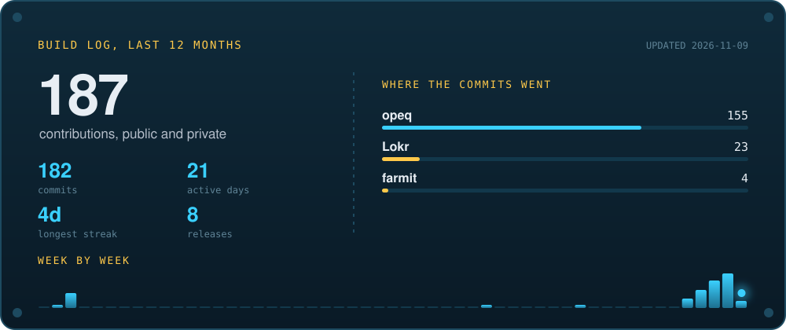

  <a href="https://opeq.io">opeq.io</a> &nbsp;|&nbsp;
  <a href="https://x.com/Sercan0x">X @Sercan0x</a> &nbsp;|&nbsp;
  <a href="https://www.npmjs.com/package/@opeqlabs/sdk">npm @opeqlabs/sdk</a> &nbsp;|&nbsp;
  <a href="https://github.com/Sercan0x/opeq/releases">Releases</a>

I build OPEQ: quantum-resistant accounts for Solana and EVM networks.

Every wallet on Solana and Ethereum today rests on Ed25519 or ECDSA, and a large enough quantum computer can recover those private keys from public data. OPEQ accounts sign with one-time hash-based signatures (WOTS+) that rest only on hash functions. No protocol change, no new chain: they run on mainnet today.

Everything is open source and built by hand, with zero runtime dependencies.

## Selected work

| | |
|---|---|
| **[OPEQ Wallet](https://opeq.io)** Chrome extension and web wallet. Send, swap, bridge and multisig with a quantum-resistant account. JavaScript, Solana, EVM | **[@opeqlabs/sdk](https://www.npmjs.com/package/@opeqlabs/sdk)** The wallet's own library on npm. Create accounts, send on six networks and verify any OPEQ signature offline. Node.js, zero dependencies |
| **[OPEQ USB](https://github.com/Sercan0x/opeq/releases)** The whole wallet on a USB stick. Double-click to open, nothing to install, keys never touch the hard drive. Offline-first | **[OPEQ Scan](https://opeq.io/scan)** Paste any address and see how exposed it is to a future quantum attack. Solana, EVM |
| **[EVM accounts](https://github.com/Sercan0x/opeq)** One address on Ethereum, Base, Arbitrum, Robinhood Chain and Elysium, verified on chain by a WOTS+ smart account. Solidity | **[Solana program](https://github.com/Sercan0x/opeq)** A program-derived account with no Ed25519 key behind it. Any program, one hash-based signature. Solana mainnet |

## Toolbox

## Build log

Rebuilt every Monday by a GitHub Action in this repository from GitHub's public API.
