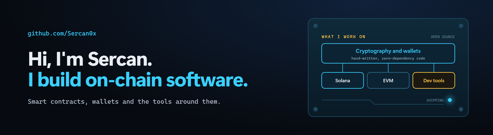

  <a href="https://x.com/Sercan0x">X @Sercan0x</a> &nbsp;|&nbsp;
  <a href="https://opeq.io">opeq.io</a> &nbsp;|&nbsp;
  <a href="https://farmit.chat">farmit.chat</a>

I build on-chain software: wallets, smart contracts and the cryptography under them, on Solana and EVM networks. I like small, hand-written code that people can read and check.

What I work with:

- **Smart contracts** on Solana and EVM chains, from vaults and account abstraction to launchpads and Uniswap V4 hooks
- **Wallets and signing**, including post-quantum (hash-based) signatures, multisig and offline verification
- **Applied cryptography** written from scratch: SHA-256, Keccak, secp256k1, WOTS+
- **Backends and infrastructure** on Cloudflare Workers, RPC proxies, indexers and real-time apps
- **Developer tools**: SDKs, test harnesses, fork tests and release pipelines

## Selected work

| | |
|---|---|
| **[OPEQ](https://github.com/Sercan0x/opeq)** Quantum-resistant accounts for Solana and five EVM chains: Chrome wallet, USB edition, multisig and bridge. JavaScript, Solidity, Solana | **[@opeqlabs/sdk](https://www.npmjs.com/package/@opeqlabs/sdk)** Hash-based accounts in a few lines of code, with offline signature verification. Node.js, zero dependencies |
| **[farm it?](https://github.com/Sercan0x/farmit)** Airdrop rooms the project does not run. One vote per room: farm it, or skip it. Python, WebSockets from scratch | **[Lokr](https://github.com/Sercan0x/Lokr)** USDC vault on Arc with spending limits, whitelists and an emergency pause. Solidity, JavaScript |

## Toolbox

## Build log

Rebuilt every Monday by a GitHub Action in this repository from GitHub's public API.
